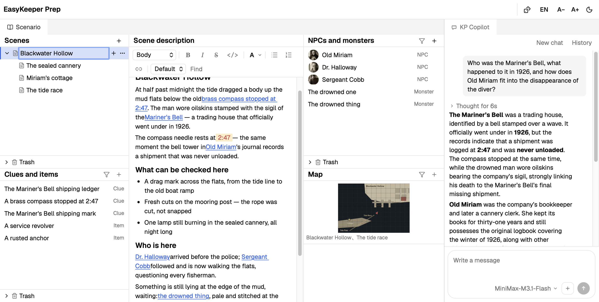

[简体中文](README_zh.md) | English

## EasyKeeper

A tabletop RPG toolbox designed for CoC Keepers — open source, free, and connects to any AI service.

### Features

- **Structured scenario**: Organize your scenario as a tree of scenes, and turn NPCs, monsters, items, and clues into linked entries with numeric values, so you can find what you need right away while running the game.

- **The built-in KP Copilot helps you patch the holes**: connect any popular AI service, quickly pick scenario content to add to the conversation context, and let the AI fill in what your scenario left blank.

- **Scenario and game record data kept separate**: Record status values quickly while running a game — every game keeps its own data, so nothing pollutes the scenario.

  Investigator sheets are created in play mode as well, written straight into the game record — they belong to that game, not to the scenario.

### Download and install

macOS only.

[Download](https://github.com/weisy11/EasyKeeper/releases)

Tested on macOS 26.5 (Apple Silicon). Intel chips are untested, but should work in theory.

### Support and feedback

EasyKeeper is currently in alpha.

If you run into any problem or bug while using it, or have suggestions about features, feel free to open an issue on this project.

### Copyright and third-party notices

#### Trademarks and non-affiliation

Call of Cthulhu® and Chaosium® are registered trademarks of Chaosium Inc. EasyKeeper is an independent project, is not affiliated with Chaosium Inc., and has not been authorized or endorsed by them.

#### User content

- EasyKeeper does not actively collect anything you create or edit in the tool.
- When you use KP Copilot, content from your scenario may be sent to the AI service as context.

#### Third-party open-source components

EasyKeeper uses many open-source components, and we would like to thank them all:

- [Tauri](https://tauri.app/)
- [Tiptap](https://tiptap.dev/)
- [React](https://react.dev/)
- [lucide-react](https://lucide.dev/)
- [dice-box-threejs](https://github.com/3d-dice/dice-box-threejs)
- [Geist](https://vercel.com/font)

### License

[Apache License 2.0](LICENSE)
