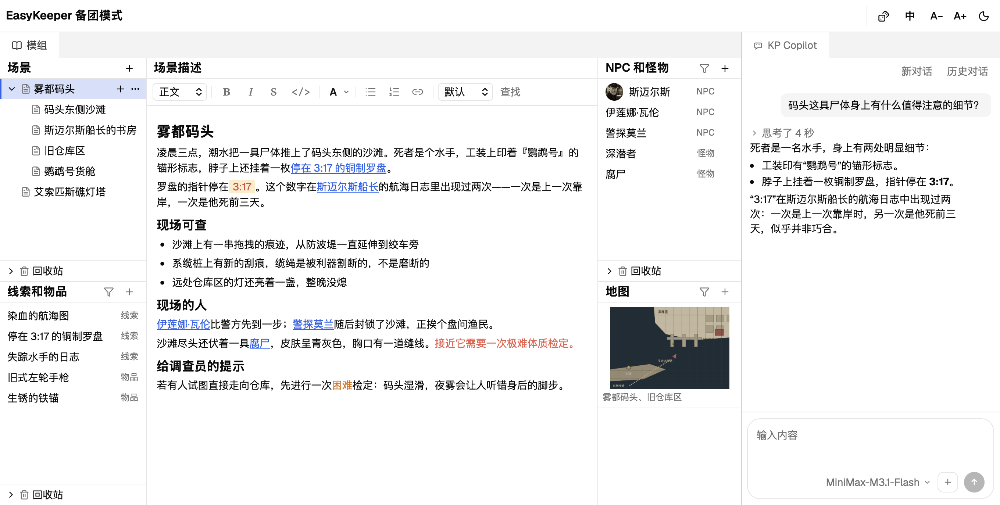

简体中文 | [English](README_en.md)

## EasyKeeper

为 CoC Keeper 设计的跑团工具箱，开源、免费，支持 AI 能力接入。

### 特性

- **结构化的跑团模组**：用树状结构的场景将模组结构化，并将 NPC、怪物、物品和线索等做成可链接、带数值的条目，让你在带团时第一时间找到想要的信息。

- **内置 KP Copilot，帮你解决补天难题**：支持接入主流 AI 服务，快速选取模组内容加入对话上下文，让 AI 补全模组中的空白。

- **模组和跑团记录数据隔离**：带团时快速记录状态数值，每一局各自记录数据，不污染模组。

  玩家的调查员角色卡也是在跑团模式下建的，直接写在跑团记录里 —— 它属于这一局，不属于模组。

### 使用文档

- [快速上手](docs/zh_CN/quick-start.md)
- [备团与跑团](docs/zh_CN/prep-and-play.md)
- [模组工具](docs/zh_CN/scenario.md)
- [KP Copilot](docs/zh_CN/copilot.md)
- [角色工具](docs/zh_CN/character.md)
- [骰子工具](docs/zh_CN/dice.md)
- [未来计划](docs/zh_CN/about_future.md)

### 下载与安装

仅支持 macOS。

[下载链接](https://github.com/weisy11/EasyKeeper/releases)

已在 macOS 26.5（Apple Silicon）实测通过。Intel 芯片未实测，理论上同样可用。

### 支持与反馈

EasyKeeper 目前处于 alpha 阶段。

使用中遇到任何问题或 bug，或对功能有建议，欢迎在本项目提交 issue。

### 版权与第三方声明

#### 商标与非关联声明

Call of Cthulhu®（克苏鲁的呼唤）与 Chaosium® 是 Chaosium Inc. 的注册商标。EasyKeeper 是一个独立项目，与 Chaosium Inc. 没有任何关联，也未获得其授权或背书。

#### 用户内容

- EasyKeeper 不会主动收集你在工具中创建、编辑的任何内容。
- 当你使用 KP Copilot 时，可能会将模组中的内容作为上下文参考发给大模型服务。

#### 第三方开源组件

EasyKeeper 使用了大量开源组件，在此一并感谢：

- [Tauri](https://tauri.app/)
- [Tiptap](https://tiptap.dev/)
- [React](https://react.dev/)
- [lucide-react](https://lucide.dev/)
- [dice-box-threejs](https://github.com/3d-dice/dice-box-threejs)
- [Geist](https://vercel.com/font)

### License

[Apache License 2.0](LICENSE)
