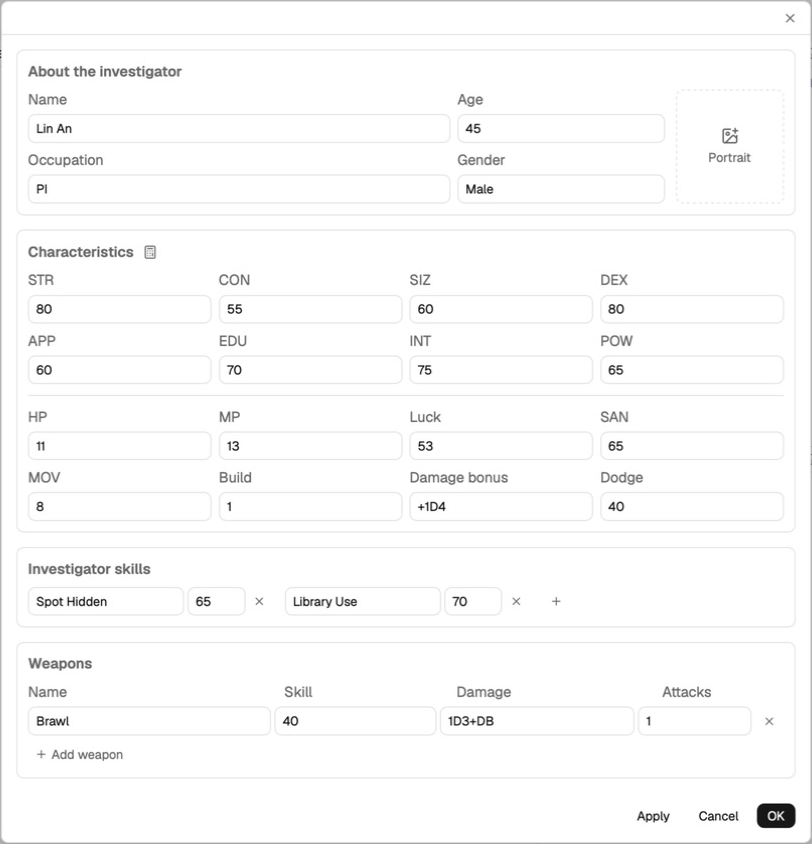
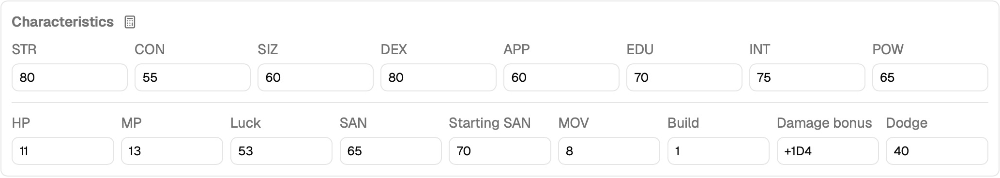
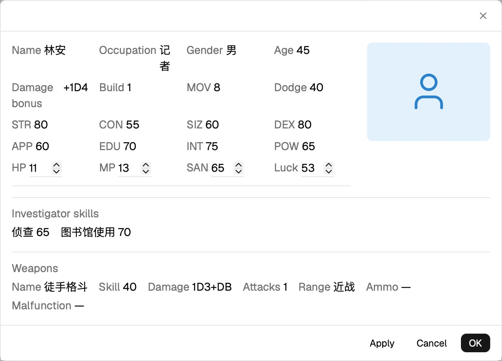
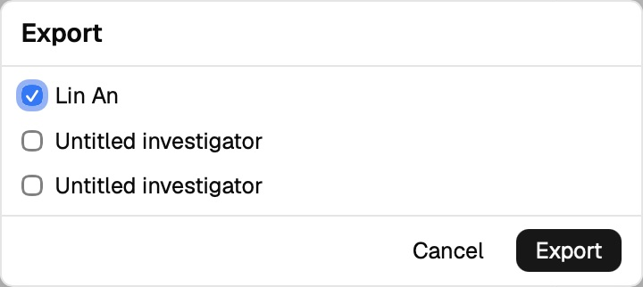

## Character Tool

[← Back to the docs index](README.md) · [简体中文](../zh_CN/character.md)

The Character tool manages the players' investigators. In play mode, the investigator list is on the right side of the workspace. You can enter character sheets, look up characteristics, skills, and weapons, and track state changes during a game. This information is saved in the current game record.

### Creating and Editing

Click the + button at the top right of the investigator list and choose **Add investigator** or **Add investigator (brief)**. The first opens a full character sheet; the brief form omits details such as backstory, gear, and wealth.

Enter the values from the player's character sheet. Click **Portrait** to add an image, or use the + buttons in the skills and weapons sections to add entries.

Click the calculator button beside **Characteristics** to calculate HP, MP, SAN, damage bonus, build, and MOV from the characteristics and age, replacing the existing values in those fields.

When you finish, click **OK** to save and close the form. Use **Apply** to save while continuing to edit. **Cancel** or the close button at the top right discards changes made since the last save. When creating an investigator, cancelling before the first **Apply** discards the new character.

To edit a character later, right-click their name in the list and choose **Edit** or **Edit (brief)**.

### Looking Up Characters and Tracking State

Click an investigator's name to open their details. The main characteristics, skills, and weapons are gathered here for quick reference during play.

HP, MP, SAN, and Luck can be edited directly. For example, if Lin An's HP drops from 11 to 9 after an injury, enter 9 here, then click **Apply** to save or **OK** to save and close. **Cancel** or the close button at the top right discards changes made since the last save.

To change skills, weapons, or personal information, close the detail view and open an editing form through the right-click menu.

### Exporting and Importing

Click the + button at the top right of the investigator list and choose **Export**. Select the characters you want, click **Export**, and choose a destination. You can export several investigators at once.

EasyKeeper creates a timestamped folder at the chosen location, containing `investigators.json` and any portrait images used by the characters. Keep the whole folder when sharing or backing up the export.

To import, open the game record that should receive the characters, click +, and choose **Import**. Select the exported folder containing `investigators.json`. Imported characters are appended to the investigator list; importing the same data again creates duplicate entries.

### Deleting an Investigator

Right-click a character's name and choose **Delete** to remove them. The Character tool has no trash, so deleted investigators cannot be restored through the interface. Export any characters you want to keep before deleting them.
