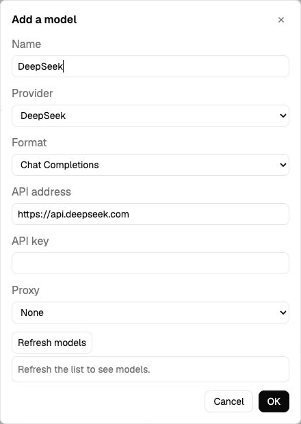
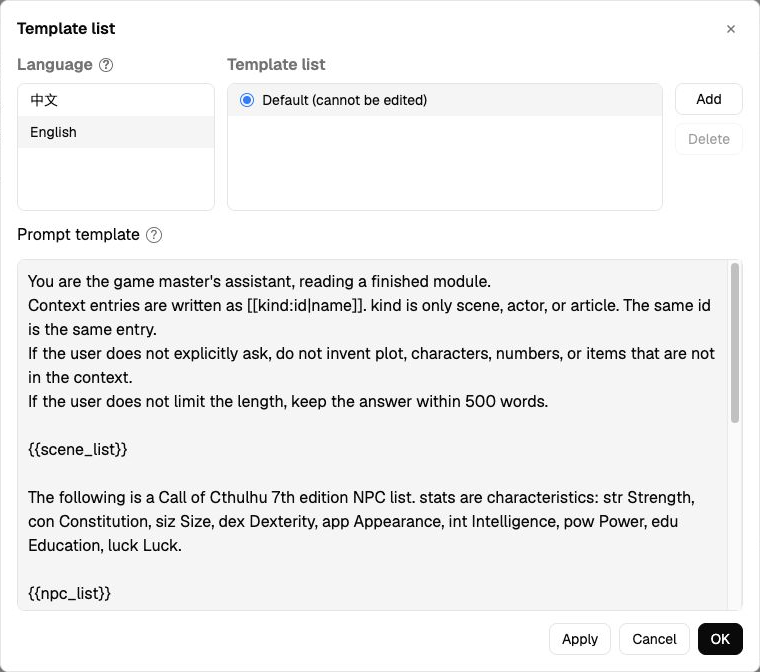

## KP Copilot

[← Back to the docs index](README.md) · [简体中文](../zh_CN/copilot.md)

KP Copilot is EasyKeeper's built-in AI assistant. In prep mode, you can find it on the right side of the workspace. Use the characters, scenes, and clues you have already prepared to develop dialogue, descriptions, and plot ideas, or as a starting point for improvisation.

Unlike asking a question in a separate AI tool, Copilot can send selected scenario entries along with your question. You do not need to keep copying scene descriptions or character backgrounds: choose the entries you want it to refer to, then explain what you need.

### Connecting a Model

Before your first conversation, you need to configure a model service. EasyKeeper does not provide a model service or charge you for model calls. You need an API key from your chosen provider, which handles any charges for its use.

When you use Copilot, scenario material selected as context may be sent to your model provider along with your question. If that material is copyright-sensitive, or you are unsure whether you may share it with a third-party service, choose what to include in the context carefully.

Below the message box, open the **Model** menu, choose **Edit Models**, then click **Add a model** to open the configuration form.

**Name** is the label EasyKeeper will display for this configuration. Choose something you can recognize easily. Selecting a provider fills in a preset API address. Options include Gemini, DeepSeek, minimax, and OpenAI. For another compatible service, choose **Custom** and enter its API address.

**Format** is the service's interface format, such as Chat Completions, Responses, or Messages. Providers support different formats, so choose one that matches your service. An option appearing in this list does not mean every provider supports it.

After entering your API key, click **Refresh models**. Once the list loads, check the models you want to use and click **OK** to save. Back in the conversation, open **Model**, find your configuration, and choose one of its models. You are now ready to chat.

You can also save the configuration before loading or selecting any models. Clicking **OK** asks you to confirm. Your connection settings and any loaded model catalog are kept, ready for you to select models later.

To change a configuration later, return to **Edit Models**, right-click its name, and choose **Edit**. A saved API key is masked; leaving the field blank keeps the existing key.

#### Proxies

If you need a proxy to reach your model service, choose **Edit proxies** from the configuration form's **Proxy** menu. Add a name, protocol, server address, and port. If the proxy requires authentication, also enter a username and password.

After saving the proxy, return to the model configuration, select it, and save that configuration. Different services can use different proxies. Leave **None** selected for a service that does not need one.

### Starting a Conversation

Choose a model, write your question in the message box, and click the send button at the bottom right. You can also press Enter to send, or Shift + Enter for a new line. Replies appear as they arrive. To interrupt a reply, click **Stop**.

For example, suppose you are preparing a lighthouse investigation, but the players want to visit the keeper's home first. You can add the lighthouse scene and the keeper's entry to the context, then ask: “Using the lighthouse keeper's background, suggest three clues at his home that lead to the lighthouse. Keep his existing motives unchanged.” This tells the model what to preserve and what to add more clearly than simply asking for a few clues.

Replies are suggestions for you to review; they are not automatically written into the scenario. You can check them and move the useful parts into your scene descriptions or other entries yourself.

### Adding Context

The model does not automatically read the entire scenario. The + button beside the message box is **Add context**, where you choose the material relevant to your question.

The window groups entries into **Scenes**, **NPCs and monsters**, and **Items and clues**. Each group has **Linked to the current scene** and **Other** sections to help you find what matters to the scene in front of you.

Copilot is primarily for developing scenario content. NPC and monster context includes characteristics, appearance, portrayal notes, background, and notes. It omits skills, weapon attacks, and status or combat values such as HP, MP, and SAN, keeping the model focused on characters and plot. If those numbers matter to a request, include them in your message.

By default, Copilot selects the current scene and its linked NPCs, items, and clues. You can select monsters and other scenes manually, or uncheck anything irrelevant. Click **OK** to use these selections in subsequent questions. Switching to another scene resets the default selection for that scene, so it is worth checking the context before asking your next question.

More context is not always better. If you only need dialogue for the lighthouse keeper, you probably do not need every scene in the scenario. Choosing relevant entries reduces distractions and the amount of input. The window shows an approximate token count for the selected material and template; it is not the total usage of the whole conversation or a final price.

Typing @ in the message box lets you choose a name from the entries already added to the context. This helps identify the exact entry you mean when characters share a name or scenes have similar titles.

When you send a question, the selected scenario material is sent to your configured model service as reference information. As you choose entries, consider whether they contain anything you do not want to share with that service.

### Prompt Templates

At the bottom of **Add context**, click **Advanced** to open the prompt template settings. If the default behavior suits you, you can leave these settings alone.

A prompt template tells Copilot how to introduce your task to the model and where to insert scenario material. The default template describes the model as the game master's assistant and asks it not to invent plot, characters, or numbers absent from the context unless you explicitly request them. If you want new material, say so in your question, as in the example above.

The built-in template cannot be edited directly. Click **Add** to make a copy of the default, double-click the copy's name to rename it, and edit its text below. For example, you could make a template specifically for NPC dialogue, asking the model to focus on motives, manner of speaking, and the current scene.

The markers `{{scene_list}}`, `{{npc_list}}`, `{{monster_list}}`, `{{item_list}}`, and `{{clue_list}}` are replaced with your selected entries of each kind. `{{user_input}}` becomes your question. Keep the markers for material you want to include: removing the NPC list marker means NPC details will not appear in that template, even if you select them in the context window. A category with no selected entries becomes an empty list.

Chinese and English have separate template lists. EasyKeeper uses the selected template for the current interface language. Choosing a language inside this window lets you edit that language's templates; it does not change the application's interface language. **Apply** saves your changes and leaves the window open; **OK** saves and closes it.

### Conversation History

At the top of Copilot, **New chat** starts a fresh conversation, while **History** lets you return to earlier discussions. To delete a conversation, right-click its history entry.

Conversation history is stored in the application's local data, separately from the scenario folder. Copying your scenario folder to someone else does not include your Copilot conversations.

If you open an old conversation while working on another scenario, Copilot warns you which scenario the conversation started in. Earlier messages may still contain material from that scenario, so starting a new conversation is usually clearer when discussing a different one.

For long conversations, Copilot attempts to summarize older content for use in later exchanges. You will see **Earlier conversation compressed**, with **Show summary** available to read it. Summaries can omit details. For character numbers, important clues, or plot decisions, continue to use your own scenario as the reference.
