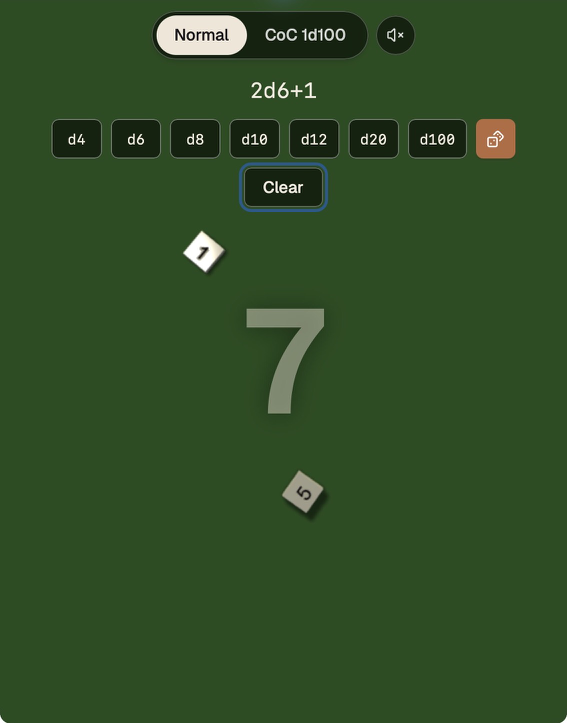
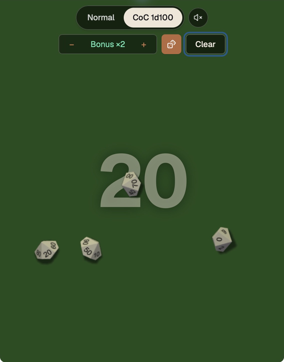

## Dice Tool

[← Back to the docs index](README.md) · [简体中文](../zh_CN/dice.md)

Click the dice icon in the main window's top bar to open the Dice tool. Use the speaker button beside the mode selector to mute or unmute dice sounds.

### Normal Rolls

Normal mode supports dice expressions such as `2d6+1`. Enter an expression, then press Enter or click the orange dice button to roll. The total appears in the center.

You can also build a roll with the dice buttons below the input. Use **Clear** to start a new selection.

In Normal mode, `d100` is a tens die. Use **CoC 1d100** mode for percentile checks.

### CoC Percentile Checks and Bonus/Penalty Dice

Switch to **CoC 1d100** for percentile checks. Use + to add bonus dice or remove penalty dice, and − to add penalty dice or remove bonus dice. Click the orange dice button to roll; the tool calculates the final result with the selected bonus or penalty dice.

