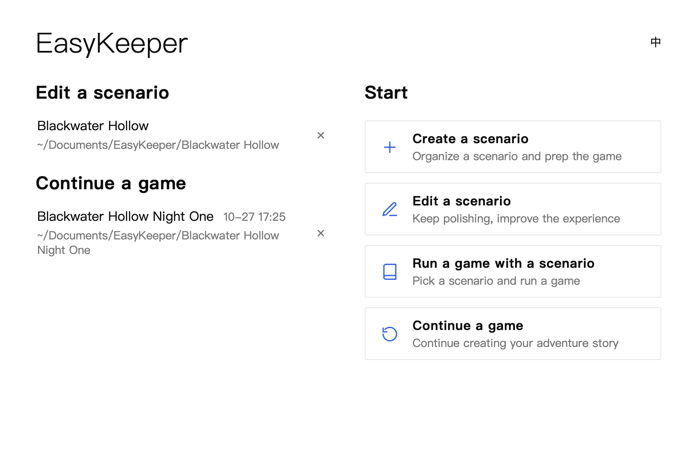
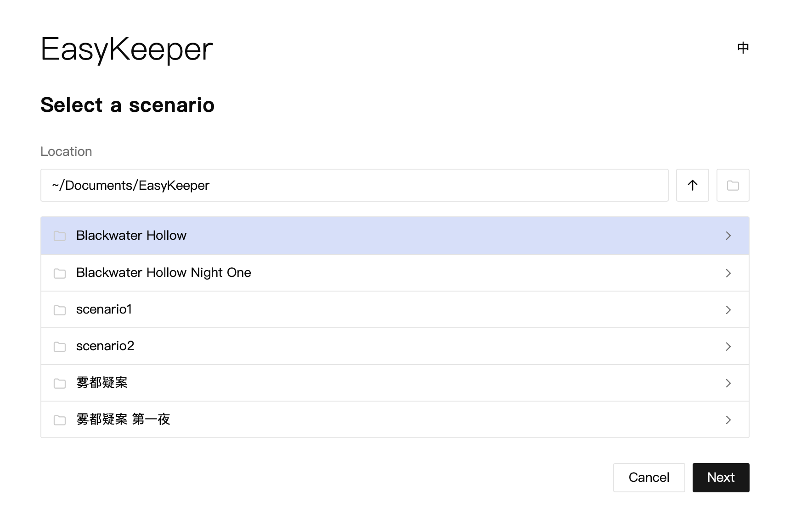
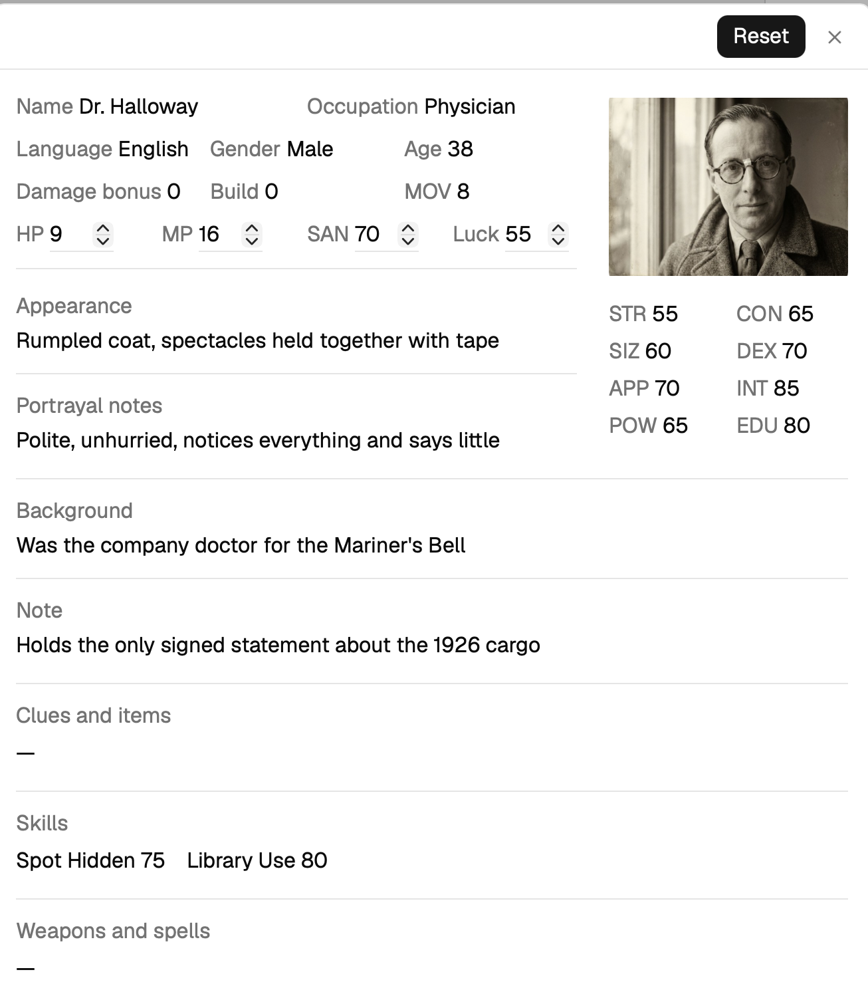

## Prep and Play

[← Back to the docs index](README.md)

When you open EasyKeeper, you land on the welcome page, where you choose between editing a scenario (prep mode) and running a game record (play mode). The tools behave differently in the two modes, and the rest of the documentation covers each of them in turn. Here we want to introduce one of EasyKeeper's most important features: the separation of data between a scenario and a game record.

There are many tools on the market for organizing a scenario. Some of them split a scenario document into structured pieces, and some even add linking features of their own. But once the game starts, you often find yourself opening a second document to keep track of things, or you simply write the data straight into the scenario document. Either way the data can get muddled, and running the same scenario for more than one group makes it worse. EasyKeeper avoids this by storing the two kinds of data separately: you can read the scenario and keep the game record in one app, and the two never get mixed up.

If this is your first time using EasyKeeper, the first thing to do is create a scenario. Here you can structure the scenario's data; the scenario guide covers these features in detail.
Once you have a scenario, you create a game record to hold the data for one session. In play mode you can read anything the scenario holds without worrying about changing it.

Take the NPC Dr. Halloway, whose starting HP is 11. A fight breaks out during the game and his HP drops to 9. All you have to do is change the HP value, right there on the sheet. The change is saved in the game record's files, so your edits never contaminate the scenario. You will also notice that in play mode everything except a handful of status values is read-only, for the same reason.
The same separation handles the harder case. If you need to run one scenario for two different groups, give each group its own game record and the two sets of data never mix.

