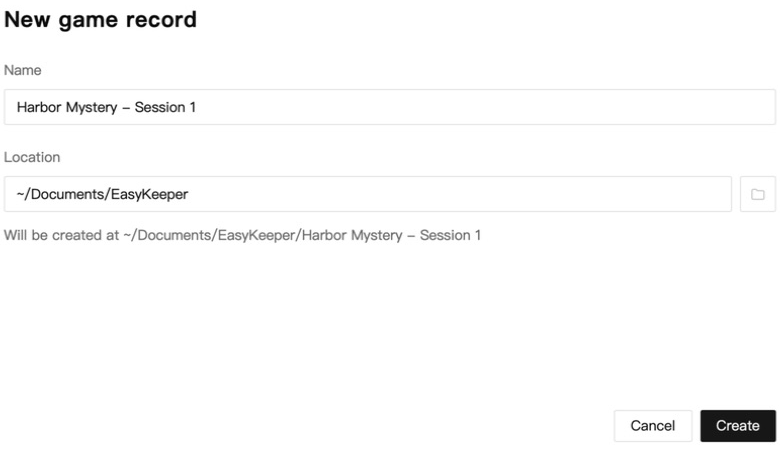
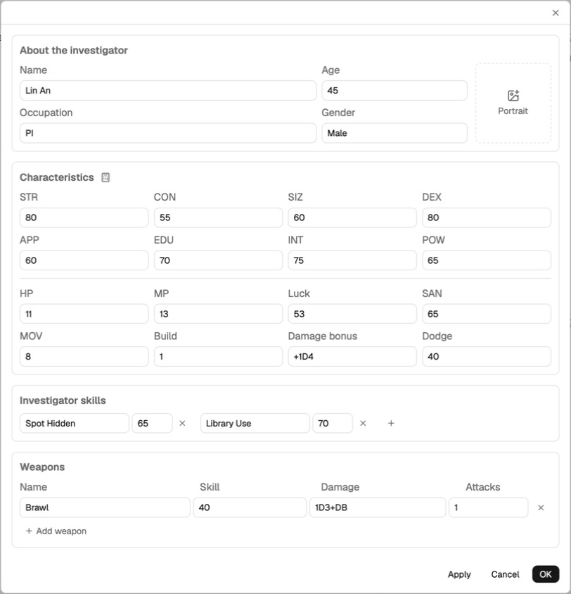
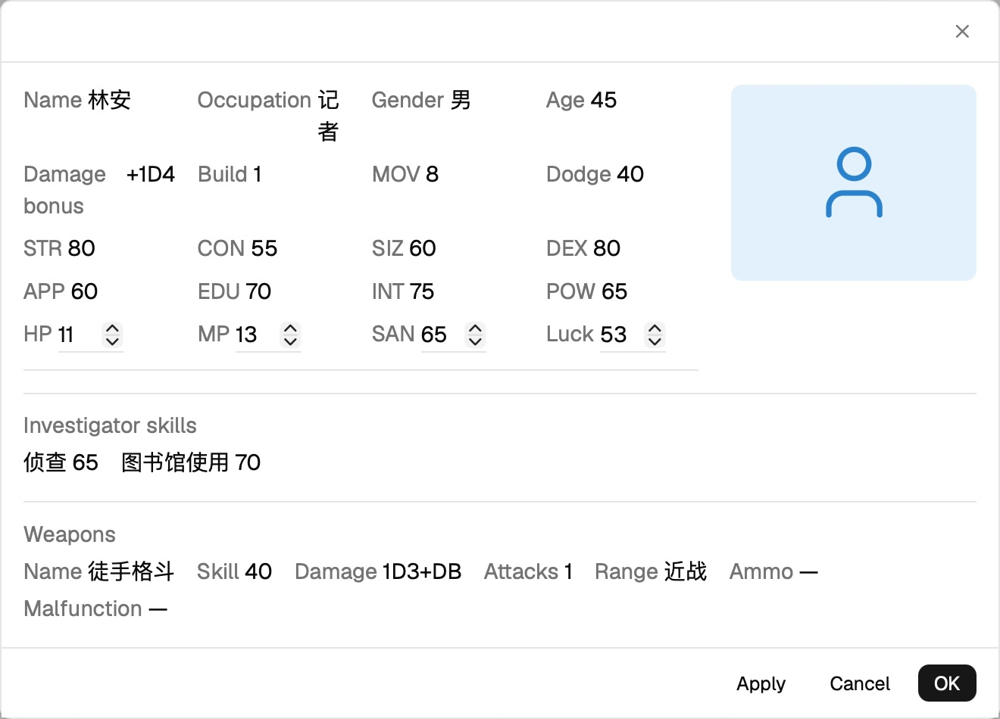

## Quick Start

[← Back to the docs index](README.md) · [简体中文](../zh_CN/quick-start.md)

EasyKeeper stores the scenario you prepare separately from the game record you use during play. You can run the same scenario for several groups, each with its own game record. See [Prep and Play](prep-and-play.md) for how they work together.

### 1. Prepare a Scenario

On the welcome page, click **Create a scenario**, enter a name and location, and create it. If you already have an EasyKeeper scenario, choose **Edit a scenario** and open its folder.

In prep mode, click + in the **Scenes** list at the top left to add a scene, then write its contents in **Scene description**. Add the NPCs, clues, and maps needed for that scene and link them to it. See the [Scenario Tool](scenario.md) for details.

To organize information or develop the story, use KP Copilot on the right. First [connect your own model service](copilot.md#connecting-a-model), then use + beside the message input to [choose context](copilot.md#adding-context) and ask your question. Selected scenario content may be sent to the model provider; choose carefully when working with copyright-sensitive material.

### 2. Create a Game Record

When you are ready to run the game, click **Run a game with a scenario** on the welcome page. Select the scenario folder, enter a name and location for this game record, and click **Create**.

In play mode, the scenario is on the left and the investigator list is on the right. Character state changes and discovered clues are saved in this game record.

### 3. Add the Investigators

Click + at the top right of the investigator list and choose **Add investigator** or **Add investigator (brief)**. Enter the information from the player's character sheet, then click **OK** to save.

Click an investigator's name to view their details, or use the right-click menu to edit them. See the [Character Tool](character.md) for character sheets, derived attributes, and importing or exporting investigators.

### 4. Run the Game

Select scenes in the list to read their descriptions and related material. During play, you can track these changes:

- When an NPC appears, click **Activate** to start tracking HP, MP, and other state values. For monsters, use + beside the template to create an individual for this game. See [Scenario Tool: NPCs and Monsters](scenario.md#npcs-and-monsters).
- When the players find a clue or item, open its details and click **Discover**. See [Scenario Tool: Clues and Items](scenario.md#clues-and-items).
- When an investigator's state changes, click their name and update HP, MP, SAN, or Luck in the detail view. See [Character Tool: Looking Up Characters and Tracking State](character.md#looking-up-characters-and-tracking-state).

To roll dice, click the dice icon in the main window's top bar. Normal mode accepts expressions such as `2d6+1`; use **CoC 1d100** for percentile checks and bonus/penalty dice. See the [Dice Tool](dice.md).

### 5. Continue Next Time

Click your record in the welcome page's **Continue a game** list to resume. If it is not listed, use **Continue a game** under **Start** and select its folder.

Use **Edit a scenario** to continue preparing the scenario. To run it for another group, choose **Run a game with a scenario** and create a separate record.
