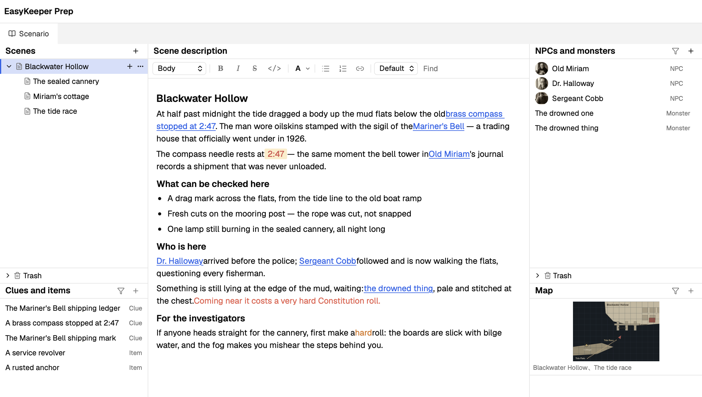
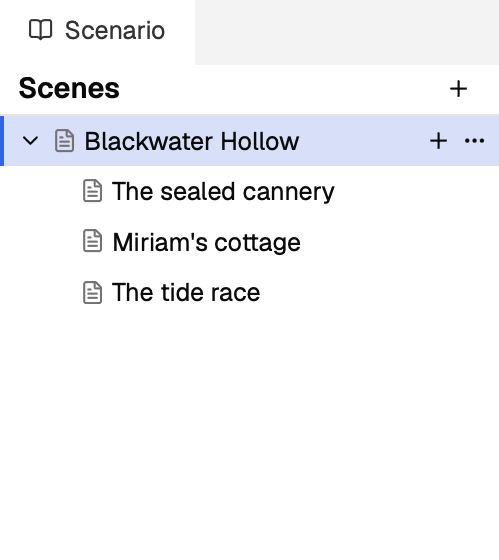
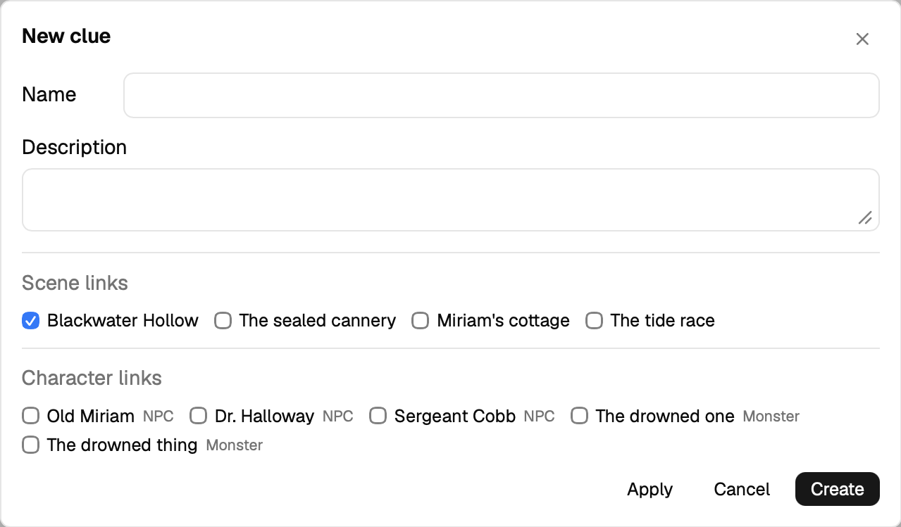
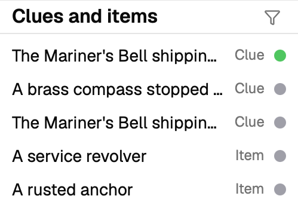
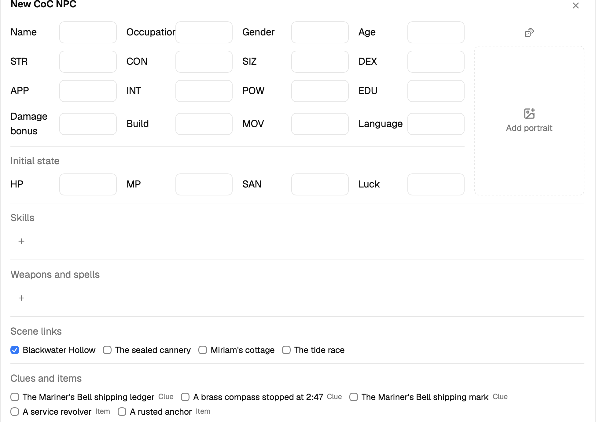
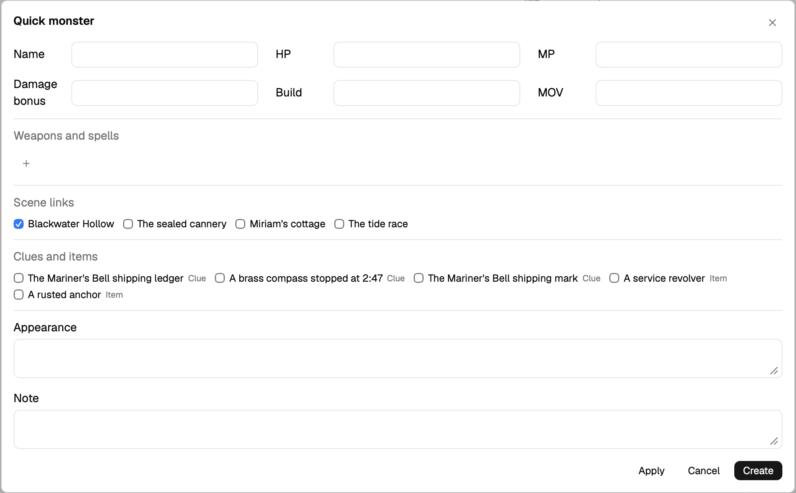
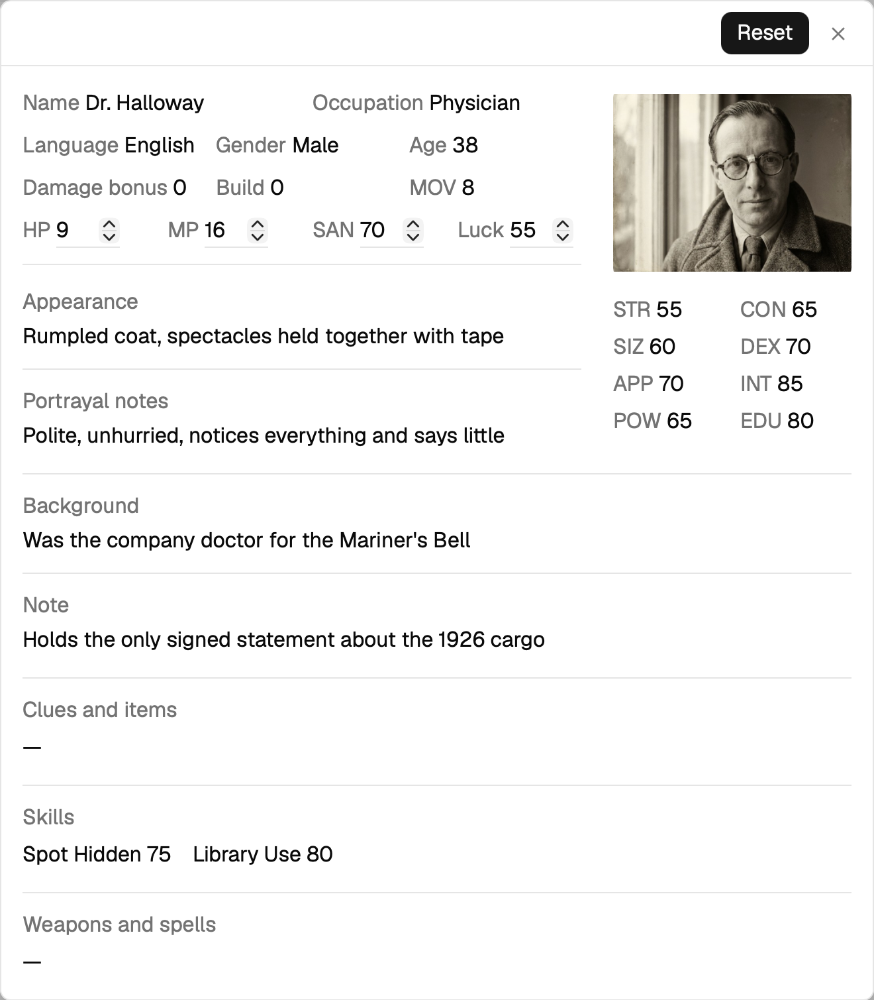
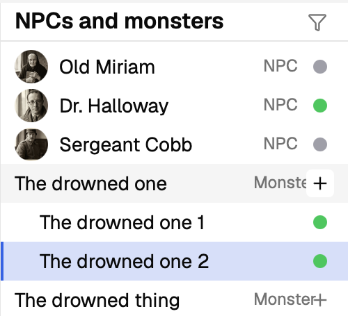
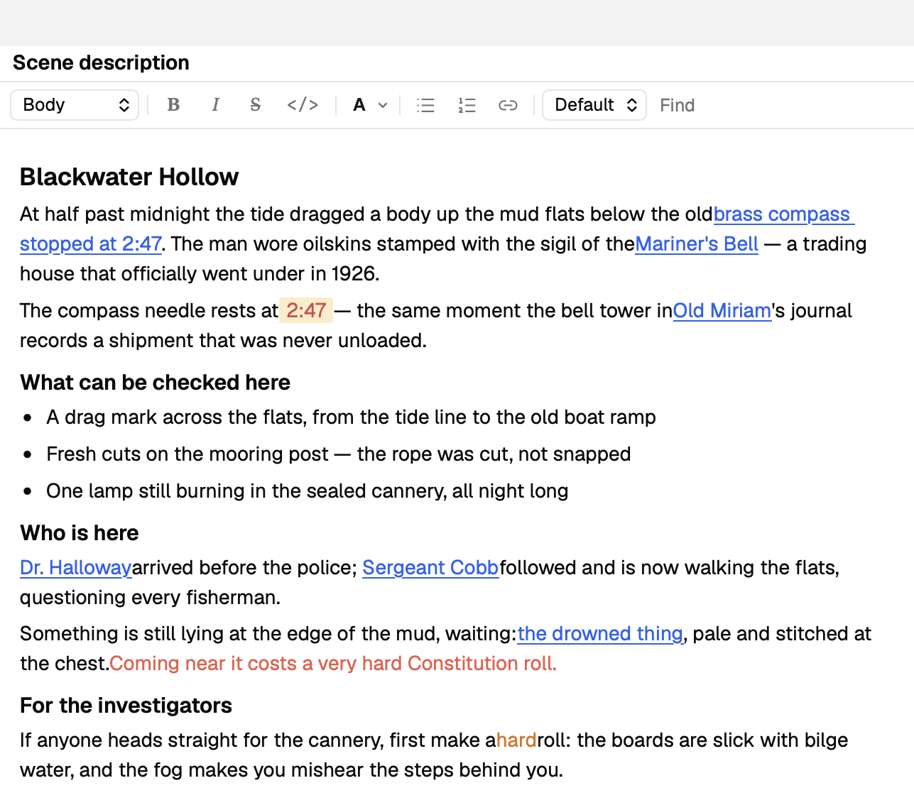
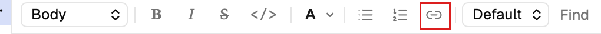

## Scenario Tool

[← Back to the docs index](README.md)

The scenario tool is the core of EasyKeeper. It lets you structure a scenario quickly, and helps you find the information you need while running a game.

When you open EasyKeeper, the scenario tool sits on the left side of the window. It is divided into five areas: the Scenes list in the top left, the Clues and items list below it, the Scene description editor in the middle, the NPCs and monsters list in the top right, and the Map list in the bottom right.

### Scene List

In EasyKeeper, we use the idea of a scene as the skeleton of a scenario: everything is organized in a tree. A scene can be a place, a time, a chapter of the story, or an event — as long as it helps you organize your scenario clearly. Every scene can have child scenes of its own, which makes the hierarchy between scenes clearer.

You create a scene by clicking the + button. Dragging a scene changes its order and its place in the hierarchy. Right-clicking and choosing Move to trash puts the entry in the trash. Deleting an entry from the trash erases its content for good, and that operation cannot be undone.

### Clues and Items

The clues and items list sits in the bottom left.

#### Prep mode

In prep mode, click the + button to create a new entry. At the bottom of the form that opens is a list of scenes and characters — tick the ones you want to link the entry to.
Click the filter button on the left of the + button to show only the entries linked to the currently selected scene.

#### Play mode

In play mode, a gray dot appears on the right of every entry. It helps you keep track of which clues and items the players have discovered. Click into an entry to open its details, where the Discover and Reset buttons in the top right change its state. You can also click the gray dot directly to mark it discovered. To avoid mistakes, clicking a green dot will not reset the state. Open the entry's details and use the Reset button instead.

### NPCs and Monsters

The NPCs and monsters list is in the top right.

#### Prep mode

In prep mode, click the + button to create an NPC or a monster.

The NPC form has a lot more fields — and you can leave any of them empty if you do not need them. Fill in an NPC's characteristics and the form calculates HP and the other derived values automatically. You can also change those numbers by hand.

The monster form is much simpler: a handful of numbers, plus weapons and spells. In play mode you can also create several copies of the same monster at once.

The line between a monster and an NPC is not absolute. You can turn a complicated monster that needs a portrayal into an NPC, or the other way around, turning throwaway NPCs — a few unimportant pirates, say — into monsters.

Both forms have link options, and the filter button in the top right filters by them.

#### Play mode

In play mode, click an entry to see its properties. The page is simpler.

When an NPC appears, click Activate in the top right to start tracking its numbers. Once it is activated, its HP, MP and the rest become editable. As mentioned above, those changes are saved to the game record, never to the scenario.
If you activated an NPC by mistake, or you want to reset its state, click Reset in the top right: the next time you activate it, its numbers go back to their initial values.

On the right of each NPC there is a dot: gray means not activated, green means activated and alive, red means dead (HP at 0).

Every NPC is unique, but a monster can appear several times. A monster you define in the scenario acts as a template: in play mode, the + button next to it creates one monster from that template, and the monsters you create are listed under the template, numbered in order. Click one of them to keep track of its state.
Monsters have the same dot on the right: green means alive, red means dead (HP at 0).

### Map

The map module sits in the bottom right, where you add image files to use as maps. Like the other components described above, a map can be linked to scenes, and the filter button narrows them down, so you can find what you need quickly while running a game.

### Scene Description

The scene description module sits in the middle of the scenario tool — it is the body editor for a scene.

#### Prep mode

Unlike the other modules, there is no preset form for the scene description: we just left a large rich text area here. We hope this lets you be as creative as you like and record anything you need.
You can write using the usual text formatting, and you can paste images straight in — for example, some screenshots of the original document.

In the toolbar above the text there is a Link button. Click it and you can insert a link to another scene, clue, item, NPC or monster.

#### Play mode

In play mode the body text cannot be edited, so you cannot accidentally pollute the scenario.

Besides reading it, you can click the links in the text to jump to the entry they point at.

### Edit Scenario

To keep the scenario clean, play mode does not let you change its content by default. But there are cases where you need to: you spot a typo while running a game, or you want to add a bit of plot on the fly. That is what the Edit scenario option in the top right is for. Switch it on and you can modify the scenario.
