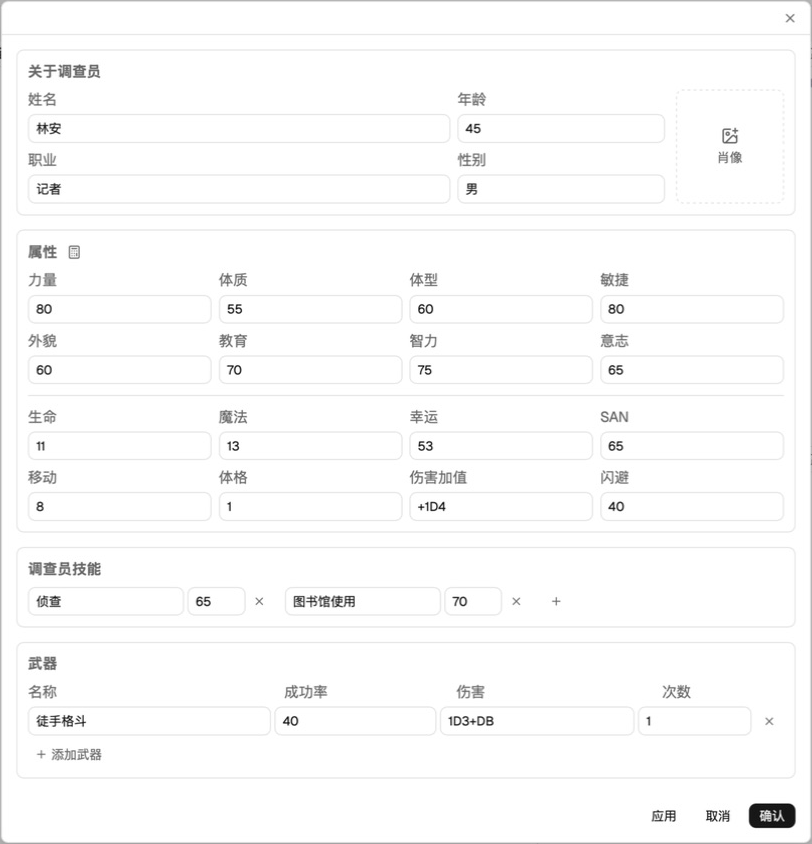
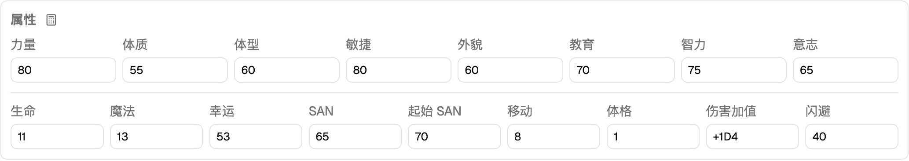
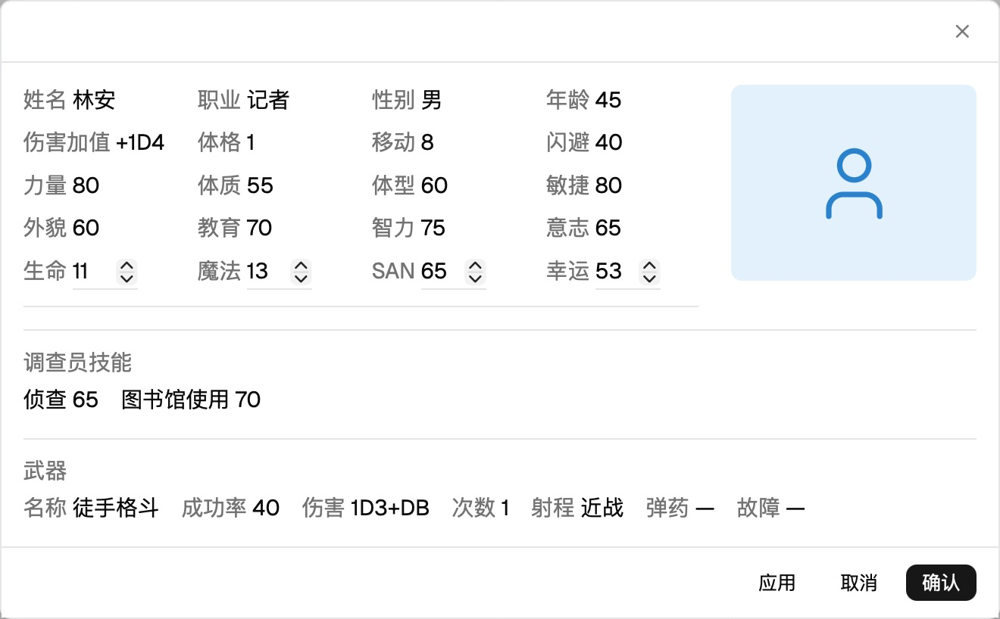

## 角色工具

[← 返回文档目录](README.md) · [English](../en_US/character.md)

角色工具用来管理玩家的调查员。进入跑团模式后，界面右侧就是调查员列表。你可以在这里录入角色卡，查看属性、技能和武器，并记录跑团过程中的状态变化。这些内容会保存在当前的跑团记录里。

### 创建与编辑

点击调查员列表右上角的 + 号，可以选择「添加调查员」或「添加调查员(简要)」。前者是完整角色卡，后者省略了背景、装备、财富等详细信息。

你可以按照玩家的角色卡填写各项内容。点击「肖像」可以添加头像，技能和武器区域的 + 号可以添加对应的条目。

点击「属性」标题旁的计算器按钮，可以根据主属性和年龄计算生命、魔法、SAN、伤害加值、体格和移动，并覆盖这几个字段原有的数值。

填写完毕后，点击「确认」保存并关闭表单。如果还要继续编辑，可以点击「应用」先保存当前内容。「取消」或右上角的关闭按钮会放弃尚未应用的改动；新建人物时，如果还没有点击过「应用」，则会放弃这次新建。

需要再次编辑时，右键点击列表中的人物名称，选择「编辑」或「编辑（简要）」。

### 跑团时查看与记录

单击调查员名称，可以打开人物详情。主要属性、技能和武器都集中在这里，方便你在带团时查看。

生命、魔法、SAN 和幸运可以直接修改。例如，林安受伤后生命从 11 降到了 9，你可以在这里将生命改为 9，然后点击「应用」保存，或点击「确认」保存并关闭。「取消」或右上角的关闭按钮会放弃尚未保存的改动。

如果需要修改技能、武器或人物资料，可以关闭详情，再通过右键菜单进入编辑表单。

### 导出与导入

点击调查员列表右上角的 + 号，选择「导出信息」，勾选需要导出的人物，再点击「导出」并选择存放位置。你可以一次导出多名调查员。

导出后，EasyKeeper 会在所选位置创建一个带时间的文件夹，里面包含 `investigators.json` 和人物使用的肖像图片。分享或备份时，请保留整个文件夹。

导入时，先打开接收角色的跑团记录，再点击 + 号，选择「导入信息」，选中包含 `investigators.json` 的导出文件夹即可。导入的人物会追加到调查员列表中，重复导入会产生重复的条目。

### 删除调查员

右键点击人物名称，选择「删除」可以移除调查员。角色工具没有回收站，删除后无法从界面恢复，需要保留的人物可以先导出。
