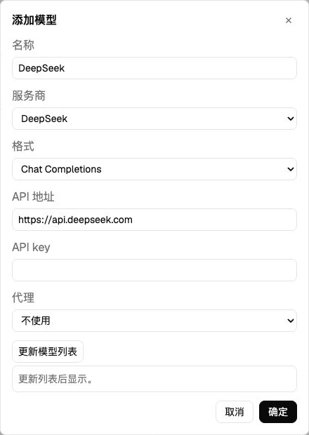
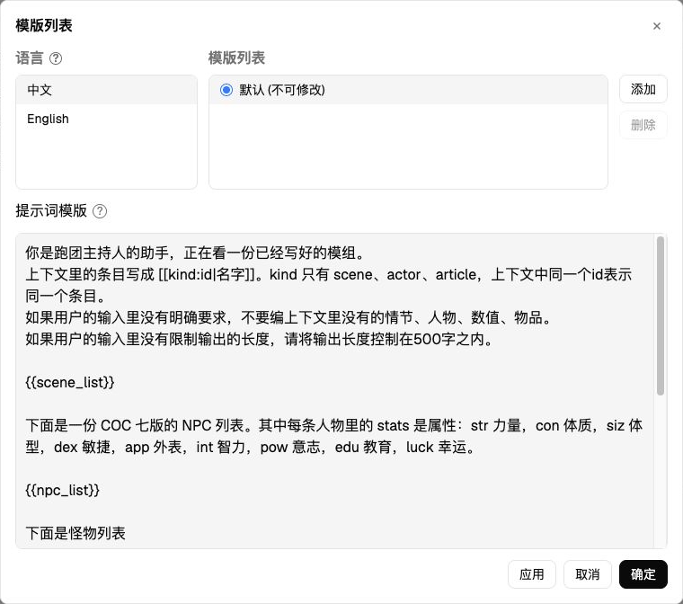

## KP Copilot

[← 返回文档目录](README.md) · [English](../en_US/copilot.md)

KP Copilot 是 EasyKeeper 内置的 AI 助手。在备团模式下，你可以在界面的右侧找到它。你可以让它根据已有的人物、场景和线索补充对话、描写或剧情，也可以在需要补天的时候找一些灵感。

与直接在其他 AI 工具中提问不同，KP Copilot 可以将你选中的模组内容一起交给模型。你不需要反复复制场景描述或人物设定，只要选好需要参考的条目，再说明你想做什么就可以了。

### 接入模型

第一次使用之前，你需要先配置自己的模型服务。EasyKeeper 本身不提供模型服务，也不会向你收取模型调用费用。你需要从使用的服务商那里获取 API key，调用产生的费用由对应的服务商收取。

使用 Copilot 时，你选择加入上下文的模组内容可能会随提问一起发送给大模型服务商。如果这些内容涉及版权，或你不确定是否可以交给第三方服务处理，请谨慎选择加入上下文的内容。

在输入框下方，你可以看到「模型」按钮。点击后选择「编辑模型」，再点击「添加模型」，就可以打开配置表单。

「名称」是这份配置在 EasyKeeper 中显示的名字，你可以填写一个方便自己辨认的名称。选择服务商后，API 地址会按照预设填入。你可以看到 Gemini、DeepSeek、minimax 和 OpenAI 等选项，如果你使用的是其他兼容服务，也可以选择「自定义」，填写自己的 API 地址。

「格式」指的是服务使用的接口格式，例如 Chat Completions、Responses 或 Messages。不同服务支持的格式并不相同，选择时要与你的服务对应，不能只因为列表里有这个选项就随意切换。

填写 API key 后，点击「更新模型列表」。列表加载完成后，你需要勾选想要使用的模型，再点击「确定」保存。回到对话页面，打开「模型」菜单，找到刚才的配置并选择其中的一个模型，就可以开始对话了。

暂时没有获取到模型，或没有勾选任何模型时，也可以保存配置。点击「确定」后会提示确认；保存后，连接信息和已获取的模型列表会保留，等你勾选模型后再开始使用。

如果你之后想修改这份配置，可以再次打开「编辑模型」，右键点击配置名称并选择「编辑」。已经保存的 API key 不会直接显示出来，留空可以保留原来的 key。

#### 代理

如果访问模型服务需要使用代理，你可以在配置表单的「代理」选项里打开「编辑代理」，添加代理服务器。填写名称、协议、服务器地址和端口，如果代理需要认证，再填写用户名和密码。

保存代理后，还需要回到模型配置中选中它，并保存这份配置。不同的模型服务可以使用不同的代理；不需要代理的服务，保持「不使用」即可。

### 开始对话

选好模型后，在输入框中写下你的问题，点击右下角的发送按钮就可以了。你也可以按 Enter 发送，按 Shift + Enter 换行。模型回复时会逐步显示内容，如果你想中断这次回复，可以点击「停止」。

举个例子，假设你正在准备一段调查灯塔的剧情，玩家却想先去拜访守塔人的家。你可以把灯塔场景和守塔人的资料加入上下文，然后问：「请根据守塔人的背景，为他的家补充三条可以通向灯塔的线索，不要改变他原有的动机。」比起直接问「帮我补几条线索」，这样能让模型更清楚你希望保留什么、补充什么。

模型的回复是供你参考的内容，不会自动写进模组。你可以检查后，将合适的部分整理到自己的场景描述或其他条目中。

### 加入上下文

模型并不会自动读到整个模组。输入框旁边的 + 号是「加入上下文」按钮，你可以在这里选择这次提问需要参考的内容。

打开后，你会看到「场景」「NPC和怪物」「物品和线索」三类条目。每一类又分成「当前场景关联」和「其他」，方便你先找到眼前这一幕需要的信息。

默认情况下，Copilot 会选中当前场景，以及与它关联的 NPC、物品和线索。怪物和其他场景可以按需要手动勾选。你也可以取消不相关的条目，点击「确定」后，这些选择就会用于后续提问。切换到另一个场景时，默认选择会跟着场景重新调整，因此在提问前可以再确认一下。

Copilot 主要用于补充和创作模组内容。加入 NPC 或怪物时，上下文包含主属性、外貌、扮演提示、背景和备注，不包含技能、武器攻击、生命、魔法、SAN 等状态与战斗数值，让模型更专注于人物和剧情。需要参考这些数值时，可以在提问中补充。

上下文不需要越多越好。例如你只想补充守塔人的对话，就不一定需要将模组里的所有场景一起发给模型。选择与问题相关的内容，既能减少干扰，也能减少输入量。窗口下方会显示大致的 token 数量，它可以帮助你判断这次选入的内容有多少，但不代表整段对话的总用量或最终费用。

在输入框里输入 @，还可以从已经加入上下文的条目中选择一个名字。这样，当模组里有同名人物或相近的场景名称时，你可以明确告诉模型自己指的是哪一个条目。

发送提问时，选中的模组内容会作为参考资料发给你配置的模型服务。选择上下文时，也请留意其中是否包含你不希望交给该服务的内容。

### 提示词模版

在「加入上下文」窗口下方，你可以看到「高级模式」按钮。点击后会打开提示词模版设置。如果默认的回答方式已经够用，你可以先不修改这里。

提示词模版决定了 Copilot 怎样向模型介绍你的任务，以及把模组内容放在什么位置。默认模版会说明模型是跑团主持人的助手，并要求它在你没有明确提出时，不要自行编造上下文中不存在的剧情、人物或数值。如果你希望它帮助你补充新内容，可以像前面的例子一样，在问题里直接说明。

默认模版不能直接修改。你可以点击「添加」生成一份默认模版的副本，双击副本名称可以重命名，再在下方编辑正文。例如你可以制作一个专门用于补充 NPC 对话的模版，让模型优先考虑人物的动机、说话方式和当前场景。

模版中的 `{{scene_list}}`、`{{npc_list}}`、`{{monster_list}}`、`{{item_list}}` 和 `{{clue_list}}` 会分别换成你勾选的对应内容，`{{user_input}}` 会换成你输入的问题。编辑时需要保留你要使用的标记：如果删掉了 NPC 列表的标记，即使在上下文里勾选了 NPC，它们的资料也不会放进这份模版。某一类没有勾选内容时，对应位置会是空列表。

中文和英文各有自己的模版列表，EasyKeeper 会按照当前界面语言使用对应列表中选中的模版。在这个窗口里切换语言，是为了编辑那种语言的模版，并不会改变应用的界面语言。点击「应用」可以保存并继续编辑，点击「确定」则会保存并关闭窗口。

### 历史对话

Copilot 顶部有「新对话」和「历史对话」两个入口。想换一个话题、重新整理思路时，可以点击「新对话」；需要继续之前的讨论时，可以从「历史对话」中打开。右键点击历史条目可以删除对应的对话。

历史对话保存在本机的应用数据中，不是模组文件夹的一部分。因此，把模组文件夹复制给别人，并不会把你与 Copilot 的聊天一起带过去。

如果你在另一个模组中打开旧对话，Copilot 会提醒你这条对话最初属于哪个模组。因为之前的消息里可能还保留着旧模组的内容，讨论新模组时，重新开始一条对话通常会更清楚。

对话较长时，Copilot 会尝试将较早的内容压缩为摘要，供后面的交流继续参考。你会看到「此前对话已压缩」的标记，也可以点击「查看摘要」阅读它。摘要可能遗漏细节，涉及人物数值、关键线索或剧情决定时，仍然需要以你自己的模组内容为准。
