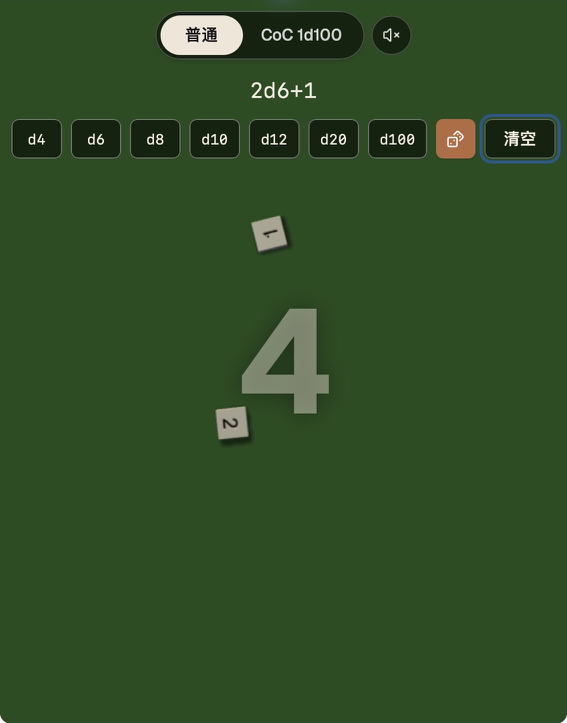
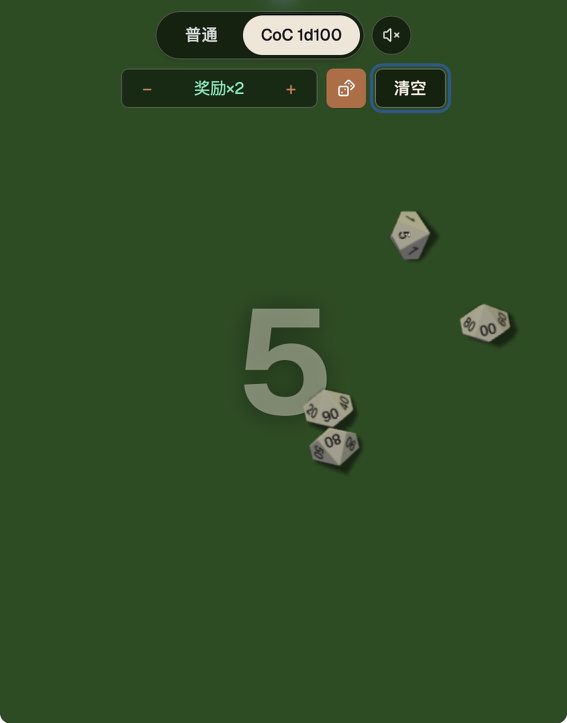

## 骰子工具

[← 返回文档目录](README.md) · [English](../en_US/dice.md)

点击主窗口顶栏的骰子图标，打开骰子工具。模式切换右侧的扬声器按钮可以开启或取消静音。

### 普通掷骰

普通模式支持骰子表达式，例如 `2d6+1`。输入后，按 Enter 或点击橙色的骰子图标掷骰，中央会显示总点数。

也可以点击输入框下方的骰子按钮来组合骰子，点击「清空」重新选择。

普通模式中的 `d100` 是十位骰。进行百分骰检定时，使用「CoC 1d100」模式。

### CoC 百分骰与奖惩骰

切换到「CoC 1d100」模式，可以直接进行百分骰检定。需要奖惩骰时，用 + 增加奖励或减少惩罚，用 − 增加惩罚或减少奖励，再点击橙色的骰子图标掷骰。工具会自动计算奖惩后的最终点数。

