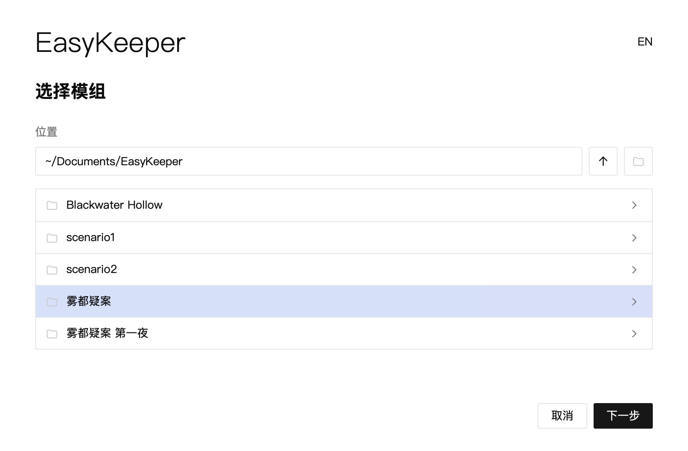

## 备团与跑团

[← 返回文档目录](README.md)

打开 EasyKeeper，你会看到欢迎页面，在这一页你要选择进行模组编辑（对应备团模式），或是进行跑团记录（对应跑团模式）。这两个模式中，各个工具的表现有许多差异，我们会在后面的章节详细介绍。在这里，我们要向你介绍 EasyKeeper 的一个重要特性，即 模组 与 跑团记录 的数据分离。

目前市面上有许多工具可以用来做模组的整理，它们也可以将模组的文档进行拆分、结构化，有的还有特色的链接功能。但是一旦开始跑团，你可能常常需要打开另一个文档来记录数据，或者，你也可以选择直接将数据记在模组的文档里。不论是哪一种方式，都可能造成数据混乱；当你使用同一个模组带多个不同的团的时候，这个问题会更为严重。为了解决这个问题，EasyKeeper 使用了分离的方式保存数据，这样可以让你在一个应用内查看模组内容、记录跑团数据，同时不会造成数据混乱。

如果你第一次使用 EasyKeeper，你首先需要建立一个模组。在这里，你可以将模组的数据结构化，我们将在模组的介绍中详细说明这些功能。
当你建好一个模组之后，你需要新建一个跑团记录来记录一次游戏的数据。在跑团模式中，你可以阅读模组的任何数据，但不用担心会破坏它们。

举个例子，我们在模组中有一个 NPC 叫斯迈尔，他的原始生命值为 11。在跑团的过程中发生了战斗，他的生命值减少到了 9 点。这时，你只要直接操作他的生命值数据就行了。这些数据会保存在跑团记录的文件中，不需要担心你的操作会污染模组的数据。你会注意到，在跑团模式中，除了个别状态值之外，其他的数据都是只读的，这同样是为了防止模组数据被不小心污染。
更复杂一点，如果你需要使用一个模组来带两个不同的团，也不需要担心数据会发生混淆，你只需要给每个团建立一个单独的跑团记录就行，它们的数据不会发生任何混淆。

