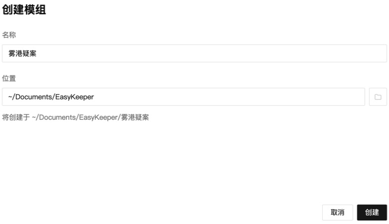
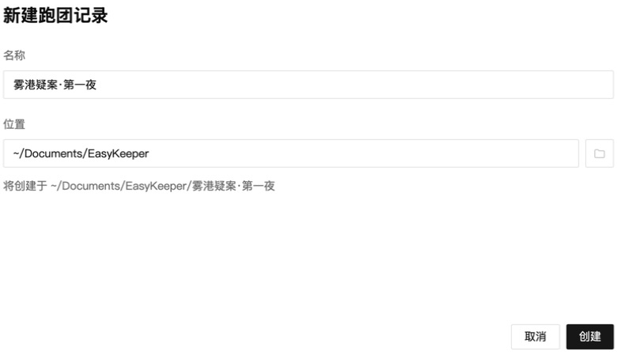
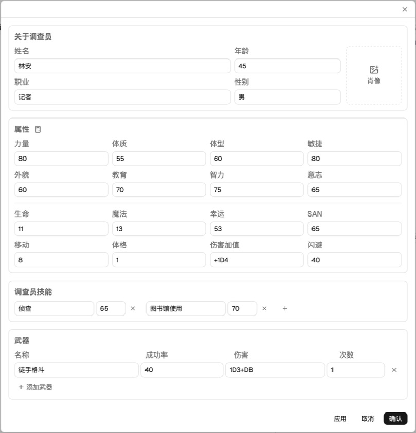
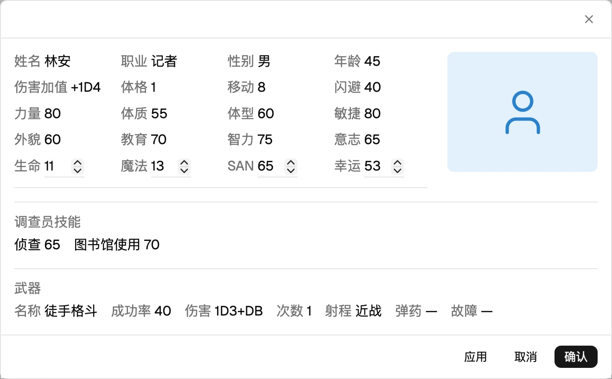

## 快速上手

[← 返回文档目录](README.md) · [English](../en_US/quick-start.md)

EasyKeeper 将备团时整理的模组与带团时产生的跑团记录分开保存。同一个模组可以用于多个团，每个团使用自己的跑团记录。关于两者的关系，见[备团与跑团](prep-and-play.md)。

### 1. 整理模组

在欢迎页点击「创建模组」，填写名称和保存位置后创建。如果已有 EasyKeeper 模组，点击「编辑模组」打开它的文件夹。

进入备团模式后，在左上角的「场景」列表点击 + 新建场景，在中间的「场景描述」中填写正文。再添加这一幕需要的 NPC、线索和地图，并将它们关联到对应场景。具体用法见[模组工具](scenario.md)。

需要整理信息或补充剧情时，可以使用右侧的 KP Copilot。先[接入自己的模型服务](copilot.md#接入模型)，再通过输入框旁的 + 号[选择上下文](copilot.md#加入上下文)并提问。选中的模组内容可能会发送到模型服务商，涉及版权敏感内容时请谨慎选择。

### 2. 建立跑团记录

准备开团时，在欢迎页点击「使用模组跑团」，选择模组文件夹，再填写这次跑团记录的名称和保存位置，点击「创建」。

进入跑团模式后，左侧可以查看模组，右侧是调查员列表。游戏中的人物状态和线索发现情况会保存在这份跑团记录里。

### 3. 录入调查员

点击调查员列表右上角的 + 号，选择「添加调查员」或「添加调查员(简要)」，按照玩家的角色卡填写资料，点击「确认」保存。

单击调查员名称可以查看角色数据，右键菜单可以再次编辑。角色卡的填写、属性计算和导入导出，见[角色工具](character.md)。

### 4. 开始带团

在场景列表中切换场景，查看正文和相关资料。跑团过程中，可以直接记录这些变化：

- NPC 登场时点击「激活」，之后可以修改它的生命、魔法等状态；怪物则通过模板右侧的 + 号创建本次出场的个体。见[模组工具：NPC 和怪物](scenario.md#npc-和怪物)。
- 玩家找到线索或物品时，将条目标记为「发现」。见[模组工具：线索与物品](scenario.md#线索与物品)。
- 调查员状态变化时，单击人物名称，在详情中修改生命、魔法、SAN 或幸运。见[角色工具：跑团时查看与记录](character.md#跑团时查看与记录)。

需要掷骰时，点击主窗口顶栏的骰子图标。普通模式支持 `2d6+1` 这样的表达式，CoC 百分骰和奖惩骰使用「CoC 1d100」模式。见[骰子工具](dice.md)。

### 5. 下次继续

在欢迎页的「继续跑团」列表中点击这份记录，就可以接着上次的进度进行游戏。记录不在列表中时，通过「开始」下的「继续跑团」选择它的文件夹。

之后要继续准备模组内容，使用「编辑模组」；要为另一个团开局，使用「使用模组跑团」建立另一份记录。
