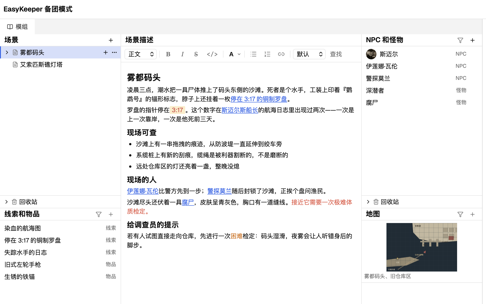
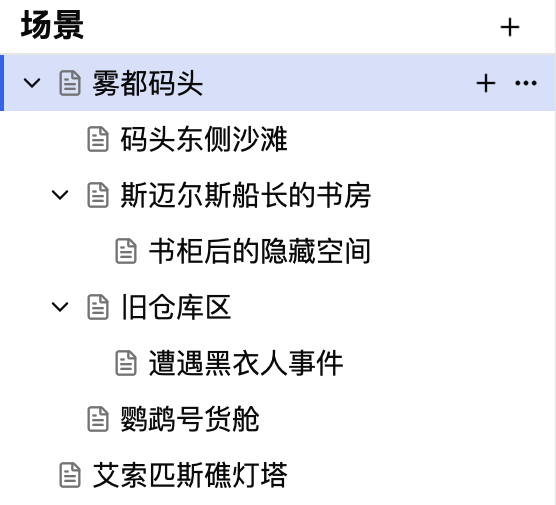
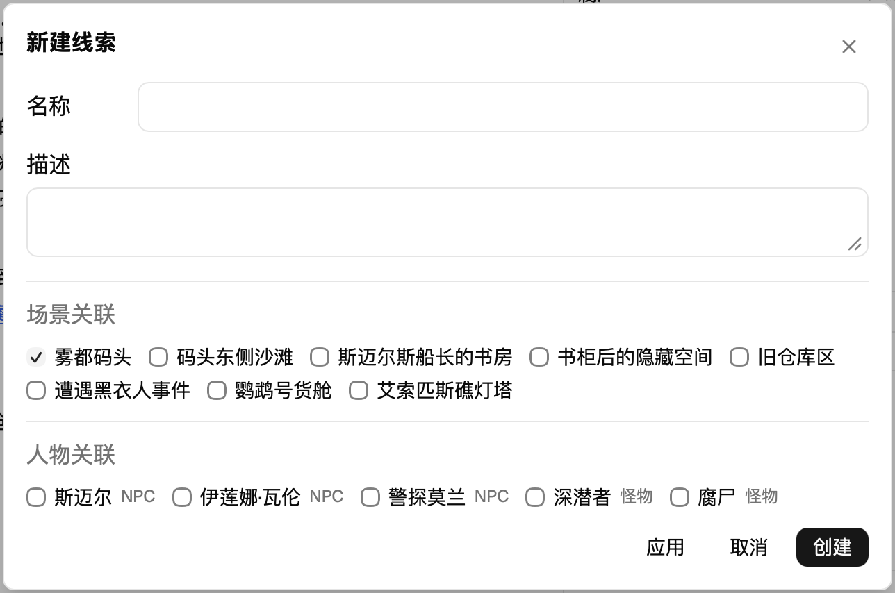
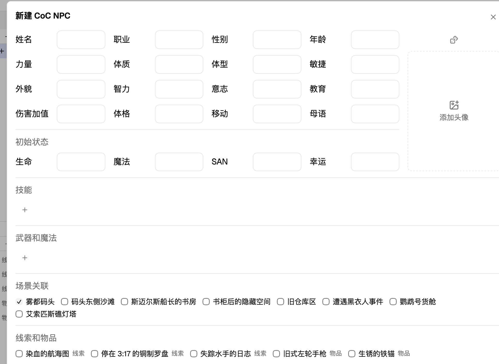
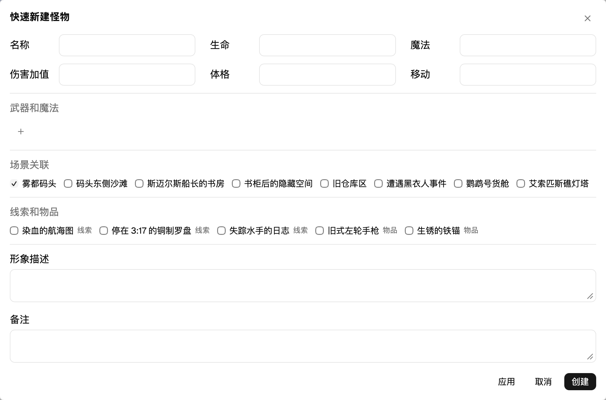
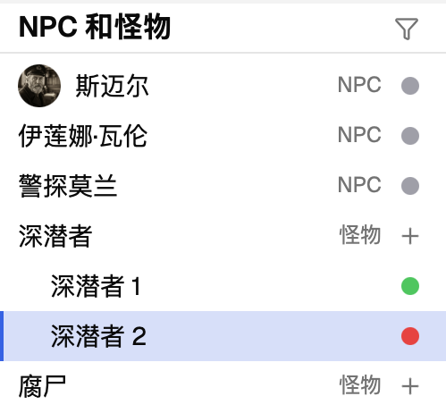
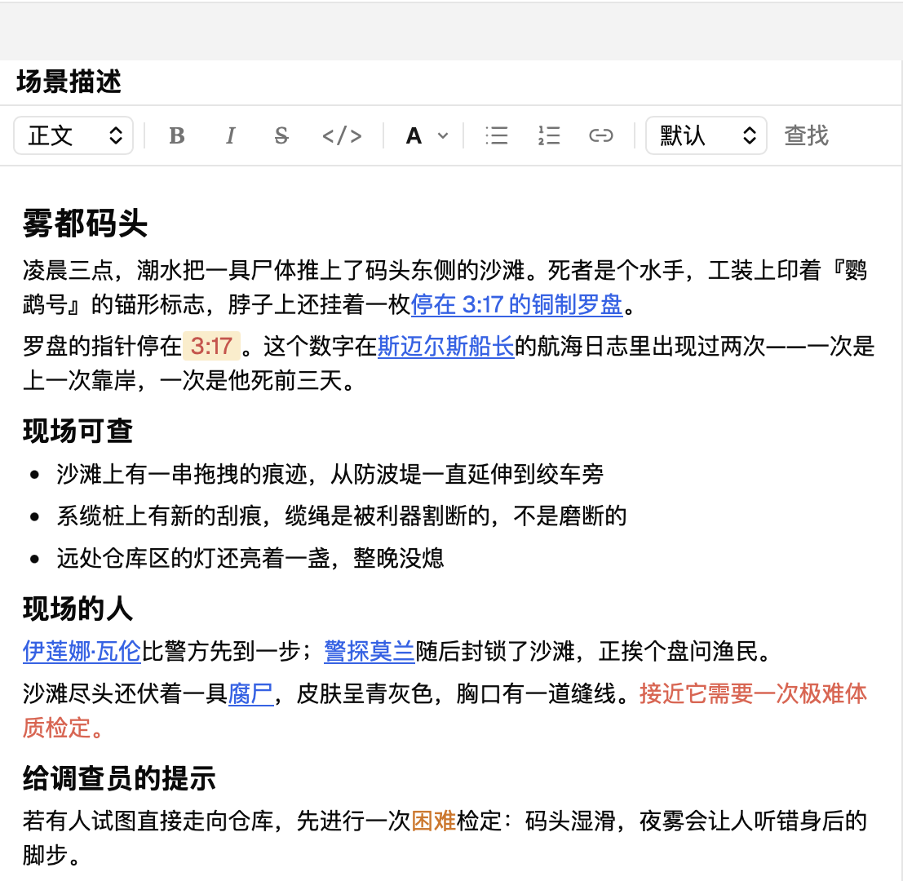

## 模组工具

[← 返回文档目录](README.md)

模组工具是 EasyKeeper 的核心工具，它可以让你快速地将一个跑团模组结构化，帮助你在带团时快速找到你要的信息。

当你进入 EasyKeeper 后，界面的左侧区域就是模组工具。它分成五个区域：左上角是「场景」列表，左下角是「线索和物品」列表，中间是「场景描述」编辑器，右上角是「NPC 和怪物」列表，右下角是「地图」列表。

### 场景列表

在 EasyKeeper 中，我们选择使用「场景」这一概念作为模组的骨架，用树状结构组织所有内容。场景可以是地点、时间，也可以是一幕剧情章节或是一个事件，只要你认为这样能清晰地组织好你的模组就可以。每个场景都可以有自己的子场景，这样场景之间的层级关系会更加明确。
你可以通过点击 + 号来创建场景。拖动场景可以改变它们的顺序和层级关系。右键并点击删除将会把这个条目移入回收站。而如果你将回收站的条目删除，它们的内容就彻底消失了，注意，这个操作不可逆。

### 线索与物品

在左下角你可以看到线索和物品列表。

#### 备团模式

在备团模式下，点击 + 号可以创建新的项目。在打开的菜单中，你可以看到下方有一个关联列表。你可以通过勾选场景或人物来为它们创建关联关系。
在 + 号的左侧你可以看到一个筛选按钮，点击后将会筛选出与当前选中的场景相关联的条目。

#### 跑团模式

在跑团模式下，你能看到条目的右侧多了一个灰色的圆点。这个标记可以辅助你记录哪些线索和物品被玩家发现了。点击进入详情页面后，你可以通过右上角的「发现」和「重置」按钮来改变状态。你也可以直接点击灰的点来「发现」。为了防止误操作，你无法点击绿点重置状态，你必须要点击条目的详情来重置。

### NPC 和怪物

右上角是 NPC 和怪物列表。

#### 备团模式

在备团模式下，点击 + 号可以创建 NPC 或怪物。

NPC 的表单更加详细，有更多的信息可以填写，当然你也可以将你不需要的条目留空。如果你填写了 NPC 的主要属性，这个表单会自动计算生命值等属性。你也可以手动修改这些数值。

怪物的条目则更加简洁，只有几个主要的数值，以及武器和魔法条目。另外，在跑团模式下，你可以快速创建若干只同样的怪物。

怪物和 NPC 的划分不是绝对的，你可以将一个复杂的、需要扮演的怪物设定为 NPC，或是反过来，将一些龙套 NPC，例如几个无关紧要的海盗，设置为怪物。

你可以在新建 NPC 或怪物的表单中添加关联选项，并通过右上角的筛选按钮进行筛选。

#### 跑团模式

在跑团模式下，你可以点击条目来查看它们的属性，这个页面会更加的简洁。

当一个 NPC 登场时，你可以点击右上角的激活，这样这个 NPC 的数值就会被追踪。点击激活后，你可以看到 NPC 的生命、魔法等条目可以编辑了。正如上面说过的，这些内容都会被记录在 跑团记录 文件里，而不会污染模组。
如果你错误地激活了一个 NPC，或者想将 NPC 的状态重置，你可以点击右上角的重置按钮，这样当你再次激活时，NPC 的数值会回到初始值。

你可以在 NPC 条目的右侧看到一个圆点标记，灰色表示未激活，绿色表示已激活且存活，红色表示死亡（生命为 0）。

在我们的工具中，每个 NPC 都是唯一的，但是怪物就可以有多个。你可以将模组中设定的怪物视为一个模板。在跑团模式下，点击怪物条目右侧的 + 号，将会用这个模板创建一个怪物。同一个模板创建的怪物会被列在模板的下方，并按顺序编号。你可以点击创建出来的怪物来记录他们的状态。
怪物的右侧同样有一个圆点来标记状态，绿色代表存活，红色代表死亡（生命为 0）。

### 地图

右下角是地图模块，你可以在这里添加地图的图片文件。与前面描述过的其他组件类似，地图也可以与场景建立关联，并通过筛选按钮进行筛选，方便你在带团时能快速找到需要的内容。

### 场景描述

在模组工具的中间是场景描述模块，也就是场景的正文编辑区。

#### 备团模式

与其他模块不同，我们并没有为场景描述预制一个表单，而只是在这里留下了一块巨大的富文本编辑区。我们希望这样的模式能让你充分发挥创造力，在这里记录任何你需要的内容。
你可以在这里使用常用的文本格式来编写内容，也可以直接粘贴图片。例如你可以将一些模组的截图放在这里。

在编辑区的功能条里，你可以看到一个「链接」按钮。点击这个按钮，你可以将其他场景、线索和物品、NPC 和怪物的条目插入到这里。

#### 跑团模式

在跑团模式下，场景描述的正文将不可编辑，以防你不小心污染模组。

除了正常的阅读功能，你可以点击场景中的链接，快速跳转到对应的条目。

### 模组编辑按钮

为了防止污染模组，EasyKeeper 的跑团模式下默认不可以修改模组的内容。但是考虑到一些特殊情况，例如你在带团的过程中发现了一个错别字，或者想临时添加一段剧情，我们在右上角设置了一个「编辑模组」的选项。当你打开「编辑模组」，你可以对模组进行修改。
